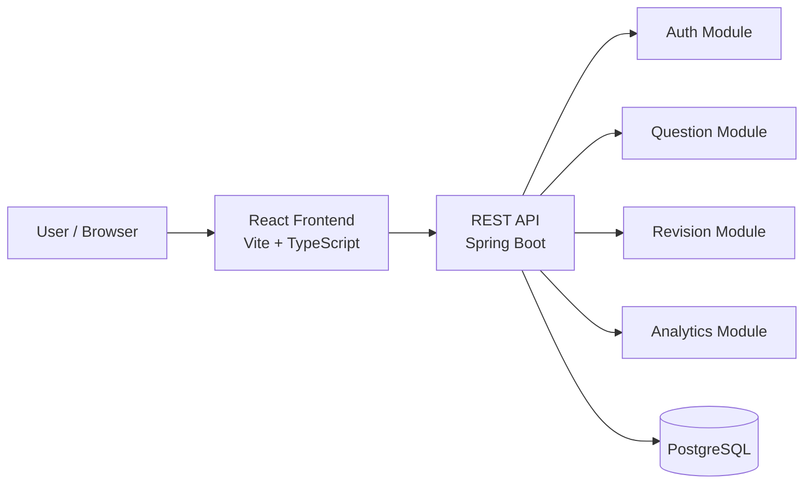
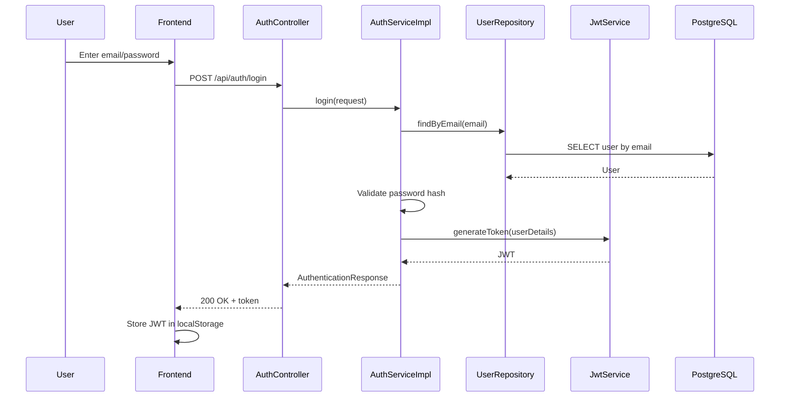
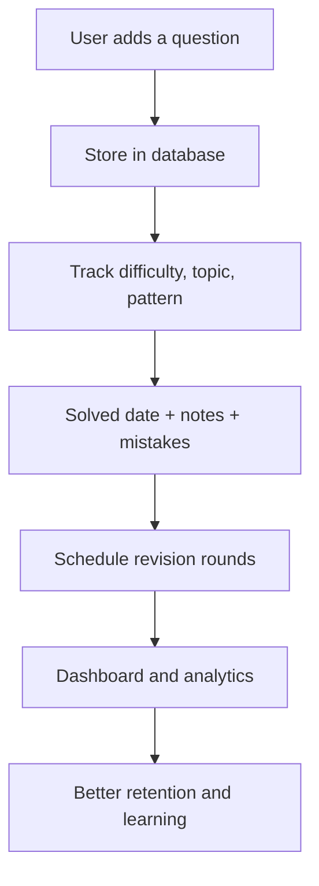
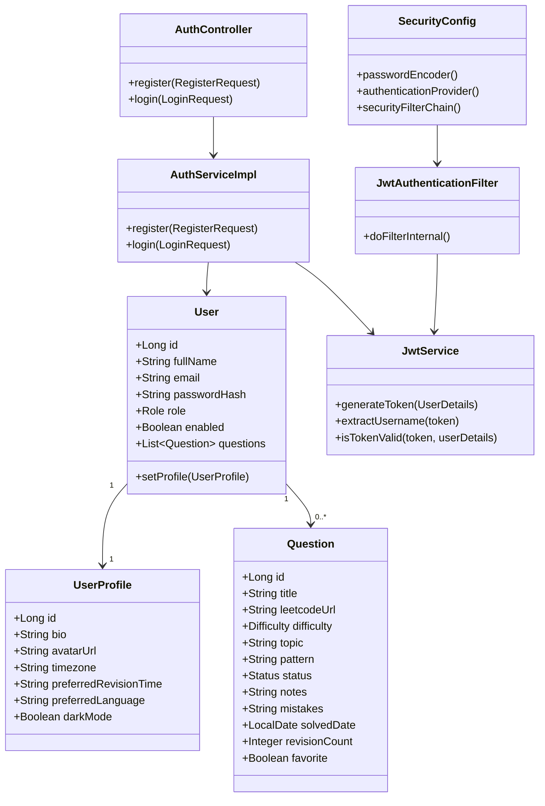

# AlgoAtlas project documentation

## 1. Project overview

AlgoAtlas is a learning and revision platform for algorithmic problem solving. It combines a Spring Boot backend with a React + TypeScript frontend to let users register, log in, track solved coding questions, and revisit them on a spaced-repetition schedule.

## 2. System architecture



## 3. Backend module map

```text
backend/
├── src/main/java/com/algoatlas/
│   ├── auth/
│   │   ├── controller/AuthController.java
│   │   ├── service/AuthService.java
│   │   ├── service/AuthServiceImpl.java
│   │   ├── repository/UserRepository.java
│   │   ├── entity/User.java
│   │   ├── entity/UserProfile.java
│   │   ├── dto/*
│   │   └── exception/*
│   ├── config/
│   │   ├── JwtProperties.java
│   │   └── SecurityConfig.java
│   ├── question/
│   │   └── entity/Question.java
│   ├── security/
│   │   ├── JwtService.java
│   │   ├── JwtAuthenticationFilter.java
│   │   ├── CustomUserDetailsService.java
│   │   └── JwtAuthenticationEntryPoint.java
│   ├── common/entity/BaseEntity.java
│   └── AlgoAtlasApplication.java
└── src/main/resources/application.yml
```

## 4. Frontend module map

```text
frontend/src/
├── components/
│   ├── dashboard/
│   ├── layout/
│   ├── questions/
│   └── ui/
├── hooks/
│   └── useAuth.ts
├── pages/
│   ├── LoginPage.tsx
│   ├── RegisterPage.tsx
│   ├── DashboardPage.tsx
│   ├── QuestionsPage.tsx
│   ├── RevisionPage.tsx
│   └── AnalyticsPage.tsx
├── routes/
│   └── AppRoutes.tsx
├── services/
│   ├── api.ts
│   ├── auth.ts
│   ├── questions.ts
│   └── analytics.ts
├── types/
│   ├── auth.ts
│   ├── question.ts
│   └── analytics.ts
├── App.tsx
└── main.tsx
```

## 5. Authentication flow



## 6. Question lifecycle workflow



## 7. Class diagram



## 8. Key design principles

- Clear separation of concerns between controllers, services, repositories, DTOs, and security.
- JWT-based stateless authentication for API access.
- Database entity fields keep business data independent from presentation concerns.
- Frontend keeps auth state in a single hook and stores token in local storage.
- The app is designed around a spaced-repetition learning loop rather than a simple task tracker.

## 9. Current status and priorities

The project is already structured around the key learning modules: authentication, question tracking, revision planning, dashboard, and analytics.

Recommended next steps:

1. Complete full question CRUD and revision scheduling endpoints.
2. Add global exception handlers for validation and auth errors.
3. Standardize frontend state management around a shared auth utility and route guards.
4. Add tests for auth, question APIs, and route behavior.

## 10. How to run

Backend:

```bash
cd backend
mvn spring-boot:run
```

Frontend:

```bash
cd frontend
npm install
npm run dev
```

## 11. Typical request flow

1. User signs in from the frontend.
2. Backend validates email/password and returns a JWT.
3. Frontend stores JWT and adds it to the Authorization header.
4. Protected routes call secure API endpoints.
5. The backend verifies the token in the security filter before processing requests.
6. The app loads dashboard, question, revision, and analytics data from the database.
